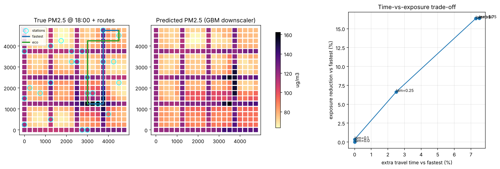

# EcoRoute AI

**Exposure-aware delivery routing.** Sparse air-quality stations are downscaled to every road
segment with machine learning, and a multi-objective router trades travel time against the
PM2.5 a rider actually breathes.



> **Status: v0.1, synthetic-city MVP.** The full pipeline runs offline against a simulated city
> with *known* ground truth. Real-data adapters (OSM, OpenAQ, ERA5) are the next milestone, see
> [`docs/ROADMAP.md`](docs/ROADMAP.md).

## Why

Routing engines optimise distance and time. Riders spend 8-12 hours a day on the road, and PM2.5
and heat vary block to block. Exposure is rarely a routing objective.

## How it works

```
sparse stations ──► downscaler (GBM) ──► PM2.5 on every road node
                                              │
road graph + congestion ──► edge cost = (1-λ)·time + λ·exposure ──► Pareto routes
```

- **Forecasting** (`ecoroute/forecast`): `HistGradientBoostingRegressor` on geographic covariates,
  time of day, and the live regional mean. Baselines: regional mean and inverse-distance weighting.
  Validated with **leave-one-station-out** CV on held-out days.
- **Routing** (`ecoroute/routing`): edge exposure = PM2.5 × time on edge. A λ sweep traces the
  time-vs-exposure trade-off.
- **Honest evaluation** (`ecoroute/evaluate.py`): routes are *planned* on predictions but *scored*
  on the true field, with an oracle planner as an upper bound.

## Quickstart

```bash
git clone <your-repo-url> && cd ecoroute-ai
python -m venv .venv && source .venv/bin/activate
pip install -e ".[dev]"
ecoroute demo --seed 0 --trips 300 --hour 18
pytest -q
```

## Example output (seed 0, 300 trips, 18:00)

```
Forecast RMSE (leave-one-station-out):  gbm 8.7 | idw 17.9 | regional mean 15.8
Routing (vs fastest, scored on true PM2.5):
  eco, predicted PM2.5:  +7.9% time, -17.8% exposure
  eco, oracle PM2.5:     +8.0% time, -19.2% exposure
```

## Read this before quoting any number

These results are a **property of the synthetic world's assumptions**, not a finding about real
cities. The simulator deliberately places higher PM2.5 along arterials plus a hidden plume. What
the numbers do validate is the *machinery*: the model beats baselines on held-out stations, and
routing on predictions captures most of the oracle benefit. Whether the real Pareto front is as
steep is the central open question, and answering it is milestone 2.

Known limitations:
- Uniform grid creates many equal-length ties, so "routes changed %" is inflated.
- No breathing-rate or heat model yet (`BREATHING_FACTOR = 1.0`).
- Single-stop trips only, no VRP.
- Static hourly snapshots, no multi-hour forecasting.

## Repo layout

```
src/ecoroute/
  data/synthetic.py      city + ground-truth PM2.5 simulator
  forecast/downscale.py  GBM downscaler, IDW baseline, LOSO CV
  routing/planner.py     cost function, planner, route scoring
  evaluate.py            experiment harness
  viz.py, cli.py
tests/                   pytest suite
docs/ROADMAP.md          learning path + milestones
```

## License

MIT
